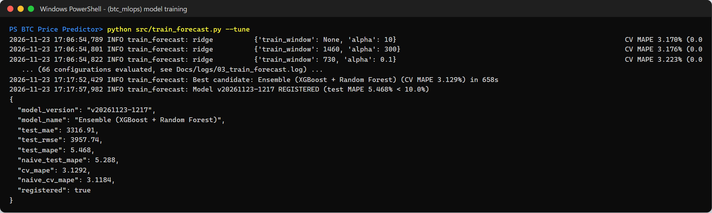

# 02 · Data Pipeline & Forecasting Model

```
etl_fetch.py ──▶ data/raw/btc_raw.csv ──▶ features.py ──▶ data/processed/btc_features.csv
                                                                     │
                                                                     ▼
                     models/model.pkl  ◀── register if MAPE < 10% ◀── train_forecast.py
                     models/metrics.json
                     models/model_version.txt
```

## 1. Extract: `src/etl_fetch.py`

- Downloads daily **BTC-USD** Open/High/Low/Close/Volume from **Yahoo Finance** (`yfinance`) starting 2017-01-01.
- If Yahoo fails, it falls back to the **Binance public API** (`BTCUSDT` daily klines).
- Removes today's row, because today's candle is still moving and is not a final daily close.
- Saves `data/raw/btc_raw.csv`.

```powershell
python src/etl_fetch.py
```

## 2. Transform: `src/features.py`

**Cleaning:** sort by date, drop duplicates and non-positive prices, re-index to a continuous daily
calendar and forward-fill any missing day.

**Indicators kept in the CSV** (also shown on the dashboard): `MA_7`, `MA_30`, `Volatility_7`, `Volatility_30`.

**Model features (21):** all built from the closing price only, and all *scale-free* (returns and ratios),
so a model trained when BTC was \$10k still works at \$100k.

| Group | Features |
|---|---|
| Lagged daily log-returns | `ret_lag_1` … `ret_lag_7` |
| Multi-day momentum | `ret_3d`, `ret_7d`, `ret_14d`, `ret_30d` |
| Moving-average gaps | `ma7_gap`, `ma30_gap`, `ma7_vs_ma30` |
| Volatility | `vol_7d`, `vol_30d`, `vol_ratio` |
| Oscillators | `rsi_14`, `range_30d` (position inside the 30-day high/low range) |
| Calendar | `dow_sin`, `dow_cos` (day of week) |

Because only closing prices are needed, the API can also forecast from a **custom price history** sent by the user.

**Targets (7):** `target_h{h} = log(Close[t+h] / Close[t])` for h = 1…7.

```powershell
python src/features.py
```

## 3. Train: `src/train_forecast.py`

### Strategy: direct multi-horizon forecasting
One model predicts all 7 future log-returns at once. The price for day *h* is
`last_close × exp(predicted_return_h)`. There is no recursive feeding of predictions, so errors
do not pile up from day to day.

### Model selection (hyper-parameter search)
Candidates: **Ridge Regression, Random Forest, Extra Trees, XGBoost, LightGBM**, plus
**averaging ensembles** of the best 2 and best 3 families. A **naive baseline** ("price stays the same")
is always reported for comparison.

- Random search: 8–16 configurations per family (66 in total), including the training-window length
  (last 2 years / last 4 years / all data) and robust loss functions (L1 / absolute error) for the boosting models.
- **Walk-forward cross-validation:** 6 folds × 60 days, each trained only on the past, with a
  **7-day purge gap** between training and validation so no future information leaks in.
- Score = price-space MAPE averaged over the 7 horizons. The best non-naive candidate wins.

### Evaluation on the latest 7-day test window (assignment C1)
The last 7 days are held out completely. The winner is retrained on data up to the forecast origin,
predicts those 7 days, and we compute **MAE, RMSE, MAPE** and the direction hit-rate. These are the
numbers `GET /metrics` returns.

### Prediction interval
The 10th and 90th percentiles of the out-of-fold errors for each horizon give an **80% range** around
each forecast (shown as the shaded band on the dashboard).

### Registration (threshold check)
The winner is refitted on all data. It is **registered** (written to `models/`) only if the test MAPE is
below `MAPE_THRESHOLD` (default **10%**, configurable by env var). Otherwise the previous model stays
live and the metrics go to `models/rejected_metrics.json`. Every run is appended to `models/registry.json`.

### Files produced

| File | Content |
|---|---|
| `models/model.pkl` | model + feature list + 80% interval + version + last 400 days of OHLCV |
| `models/metrics.json` | test metrics, naive baseline, CV result, leaderboard, test-window series |
| `models/model_version.txt` | e.g. `v20261123-1210` |
| `models/best_params.json` | best hyper-parameters per family (re-used by daily retraining) |
| `models/registry.json` | history of training runs |

```powershell
python src/train_forecast.py --tune   # full search (~6 min)
python src/train_forecast.py          # quick retrain with saved best params
```


## 4. Latest results (model `v20261123-1217`)

Data: 3,546 daily rows up to 2026-11-22. Full log: [logs/03_train_forecast.log](logs/03_train_forecast.log).



### Model leaderboard (walk-forward CV MAPE, lower is better)

| Rank | Model | CV MAPE |
|---|---|---|
| 1 | Naive (last price) | 3.118% |
| 2 | Ensemble (XGBoost + Random Forest) | 3.129% |
| 3 | Ensemble (XGBoost + Random Forest + Ridge Regression) | 3.134% |
| 4 | XGBoost | 3.140% |
| 5 | Random Forest | 3.143% |
| 6 | Ridge Regression | 3.150% |
| 7 | Extra Trees | 3.151% |
| 8 | LightGBM | 3.168% |

**Deployed model:** Ensemble (XGBoost + Random Forest) (best non-naive candidate).

### Latest 7-day test window (origin 2026-11-15, close $65,305)

| Metric | Model | Naive baseline |
|---|---|---|
| MAE | $3,317 | $3,206 |
| RMSE | $3,958 | $3,854 |
| MAPE | 5.47% | 5.29% |

| Date | Actual | Model | Naive |
|---|---|---|---|
| 2026-11-16 | $64,856 | $65,366 | $65,305 |
| 2026-11-17 | $64,894 | $65,374 | $65,305 |
| 2026-11-18 | $62,987 | $65,481 | $65,305 |
| 2026-11-19 | $61,902 | $65,447 | $65,305 |
| 2026-11-20 | $58,799 | $65,339 | $65,305 |
| 2026-11-21 | $60,094 | $65,641 | $65,305 |
| 2026-11-22 | $61,162 | $65,265 | $65,305 |

Threshold check: MAPE 5.47% < 10% → **registered**.

### How to read these numbers (honest analysis)

- Daily Bitcoin prices behave almost like a **random walk**: the best guess for next week is very close to
  today's price. That is why the naive baseline is so hard to beat, in research papers as well as here.
- All ML models land within **0.05 percentage points** of the naive baseline in cross-validation
  (3.129% vs 3.118%). The differences are smaller than the noise between folds.
- The test window (2026-11-16 → 2026-11-22) contained a sharp drop of about
  10%, which no price-only model could foresee. Both the model and the
  naive baseline missed it by a similar amount.
- What *did* help: robust loss functions (L1) for the boosting models and averaging two different model
  types (ensemble). The ensemble had the lowest CV error of all ML models.
- Ideas for improvement: external signals (ETH, S&P 500, funding rates, on-chain data, news sentiment),
  probabilistic models, and longer test windows for more reliable evaluation.
