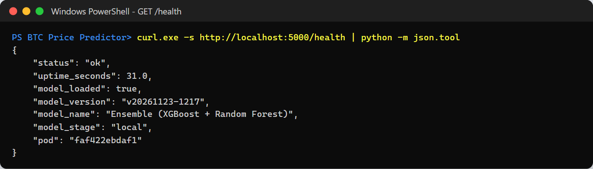
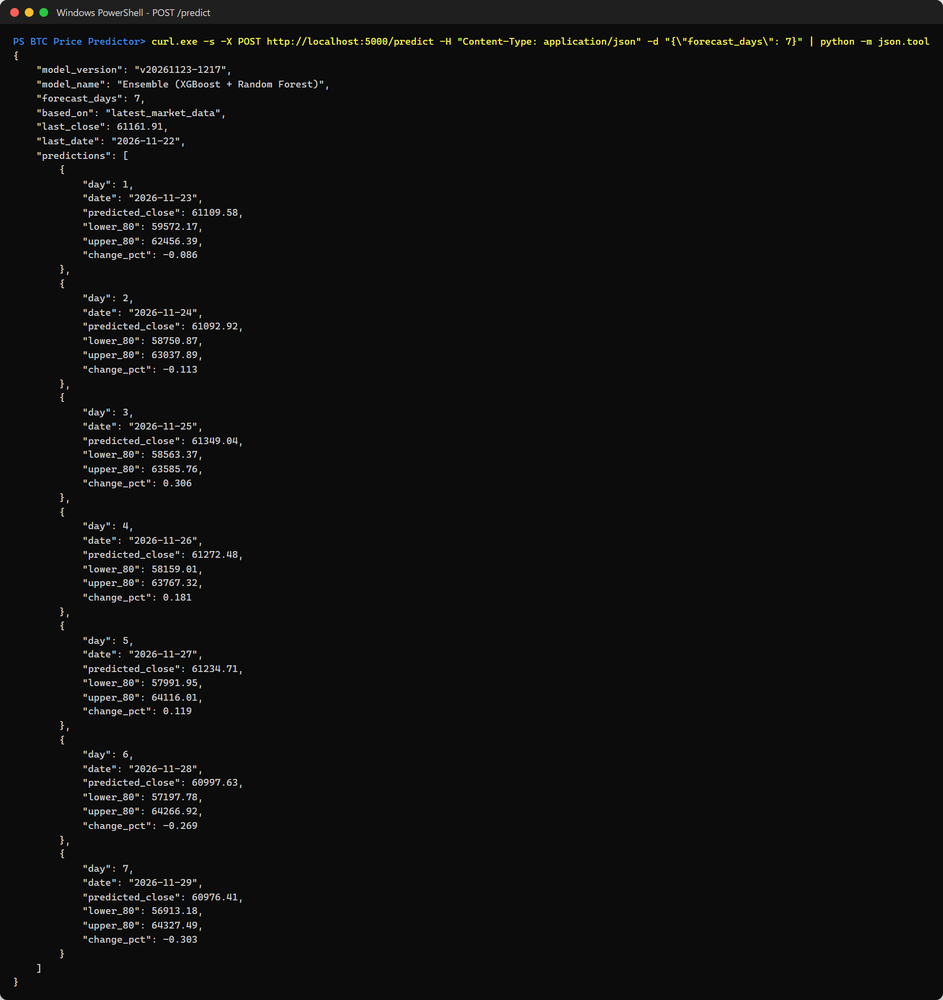
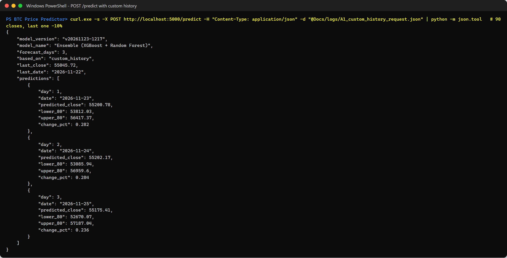
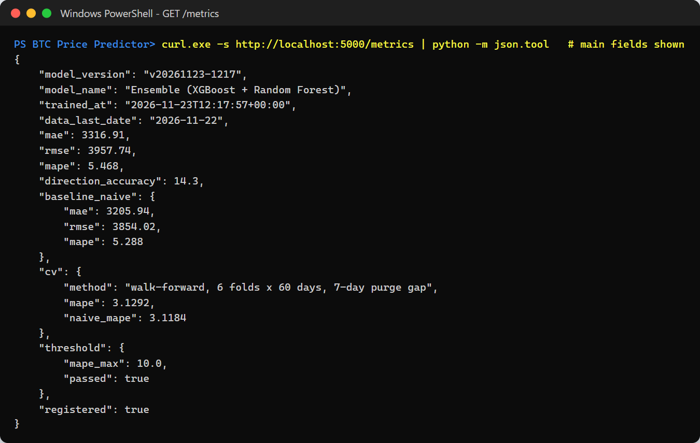
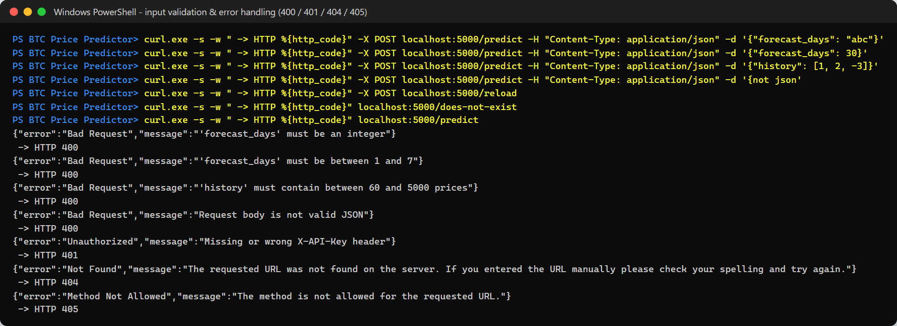
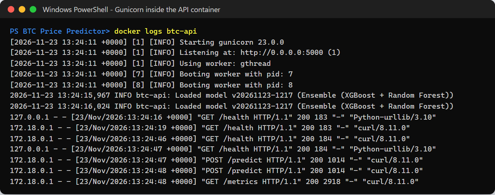
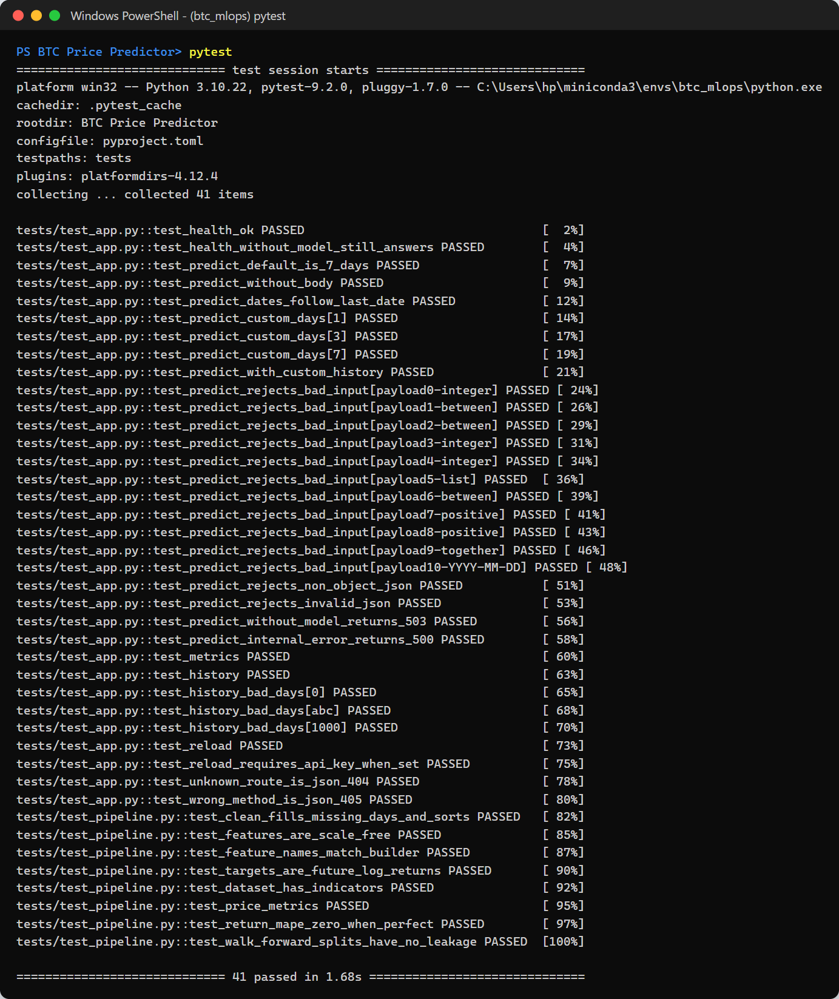

# 03 · Flask REST API (Part A)

File: [`app/app.py`](../app/app.py) · Tests: [`tests/test_app.py`](../tests/test_app.py)

## Endpoints

| Method | Path | Purpose | Success |
|---|---|---|---|
| GET | `/health` | Status, uptime, loaded model version (used by K8s probes) | 200 |
| POST | `/predict` | Forecast the next 1–7 daily closing prices | 200 |
| GET | `/metrics` | MAE / RMSE / MAPE of the latest validation run (+ baseline, CV, leaderboard) | 200 |
| GET | `/history?days=N` | Last N (1–400) days of OHLCV, for the dashboard | 200 |
| POST | `/reload` | Re-read the model from disk (called by Airflow after retraining) | 200 |

### `GET /health`
```json
{
  "status": "ok",
  "uptime_seconds": 12.4,
  "model_loaded": true,
  "model_version": "v20261123-1217",
  "model_name": "Ensemble (XGBoost + Random Forest)",
  "model_stage": "production",
  "pod": "btc-api-7d9c…"
}
```

### `POST /predict`

Request body (all fields optional):

| Field | Type | Default | Rule |
|---|---|---|---|
| `forecast_days` | integer | 7 | 1 … 7 |
| `history` | list of numbers | latest market data | 60 … 5000 positive closing prices, oldest first |
| `last_date` | `"YYYY-MM-DD"` | last date in the model data | date of the last value in `history`; only allowed with `history` |

```powershell
# default: next 7 days from the latest market data
curl -X POST http://localhost:5000/predict -H "Content-Type: application/json" -d "{\"forecast_days\": 7}"
```

Response:
```json
{
  "model_version": "v20261123-1217",
  "model_name": "Ensemble (XGBoost + Random Forest)",
  "forecast_days": 7,
  "based_on": "latest_market_data",
  "last_close": 61161.91,
  "last_date": "2026-11-22",
  "predictions": [
    {"day": 1, "date": "2026-11-23", "predicted_close": 61190.5, "lower_80": 59500.1, "upper_80": 62900.3, "change_pct": 0.047},
    "... 7 items ..."
  ]
}
```

Custom history ("what would the model say for these prices?"):
```json
{"forecast_days": 7, "history": [60000.5, 60210.0, "... at least 60 prices ..."], "last_date": "2026-11-22"}
```

### `GET /metrics`
Returns the content of `models/metrics.json`. Main keys: `mae`, `rmse`, `mape`, `direction_accuracy`,
`model_version`, `model_name`, `trained_at`, `test_window` (dates, actual, predicted, naive),
`baseline_naive`, `cv`, `leaderboard`, `threshold`.

### `POST /reload`
If the env var `API_KEY` is set, the header `X-API-Key: <API_KEY>` is required (otherwise 401).
```json
{"status": "reloaded", "previous_version": "v20261123-1217", "model_version": "v20261124-0005"}
```

## A2 · Validation & error handling

Every endpoint runs inside `try/except`, and all errors are returned as JSON:
`{"error": "<HTTP name>", "message": "<what went wrong>"}`.

| Situation | Status |
|---|---|
| Body is not valid JSON / not a JSON object | 400 |
| `forecast_days` not an integer, or outside 1–7 | 400 |
| `history` not a list, wrong length, negative/zero/non-numeric values | 400 |
| `last_date` wrong format, or sent without `history` | 400 |
| `/reload` without the right `X-API-Key` | 401 |
| Unknown URL | 404 |
| Wrong HTTP method (e.g. `GET /predict`) | 405 |
| No model loaded yet | 503 |
| Unexpected failure inside prediction | 500 (details only in the server log) |

## A3 · Production server: Gunicorn

Flask's built-in server is for development only. In Docker the API is started with:

```
gunicorn --bind 0.0.0.0:5000 --workers 2 --threads 2 --timeout 60 --access-logfile - app:app
```
(`GUNICORN_WORKERS` and `PORT` can be changed with environment variables.)

Gunicorn does not run on Windows. For local development use `python app/app.py`.

## A3 · Unit tests (pytest)

```powershell
pytest
```

- `tests/conftest.py` trains a tiny model on a **synthetic** random-walk price series, so the tests need
  no internet connection and finish in a few seconds (also in CI).
- `tests/test_app.py` covers every endpoint: happy paths, custom history, all 400 cases, 401, 404, 405, 500, 503.
- `tests/test_pipeline.py` covers cleaning, scale-free features, targets, metrics and that the CV splits have no leakage.

## How the model is loaded

1. At start-up the API reads `MODEL_DIR/model.pkl` (default `models/`, `/app/models` in Docker).
2. If that folder is empty (for example a new Kubernetes volume), it first copies the model that is baked into
   the image (`/app/seed_models`).
3. `POST /reload` swaps the model in memory under a lock, so requests keep working during a reload.

## Evidence

| | |
|---|---|
| `GET /health` |  |
| `POST /predict` |  |
| `POST /predict` with custom history (last close −10%) |  |
| `GET /metrics` |  |
| Error handling 400/401/404/405 |  |
| Gunicorn in the container |  |
| pytest: 41 passed |  |
