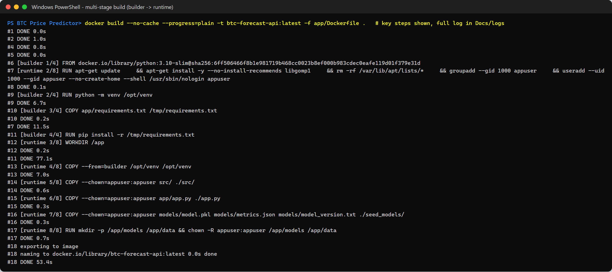
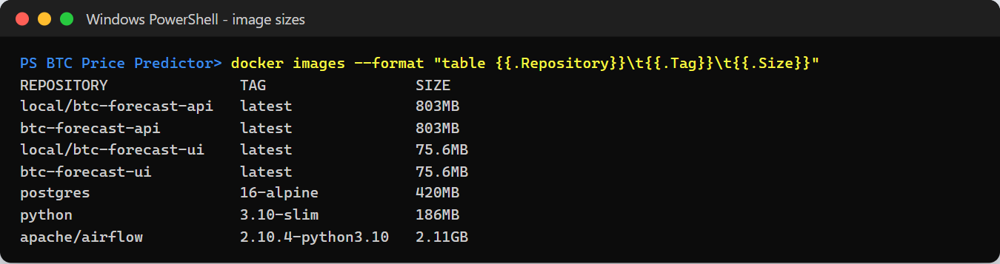
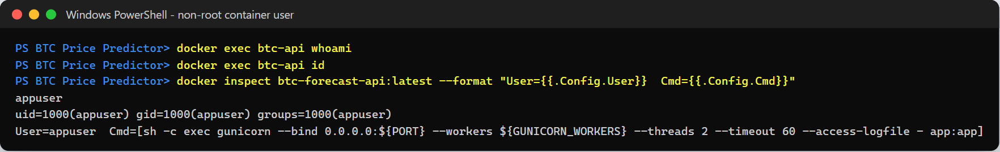
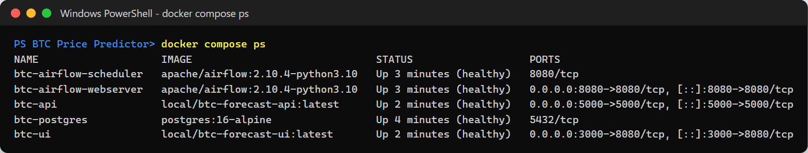
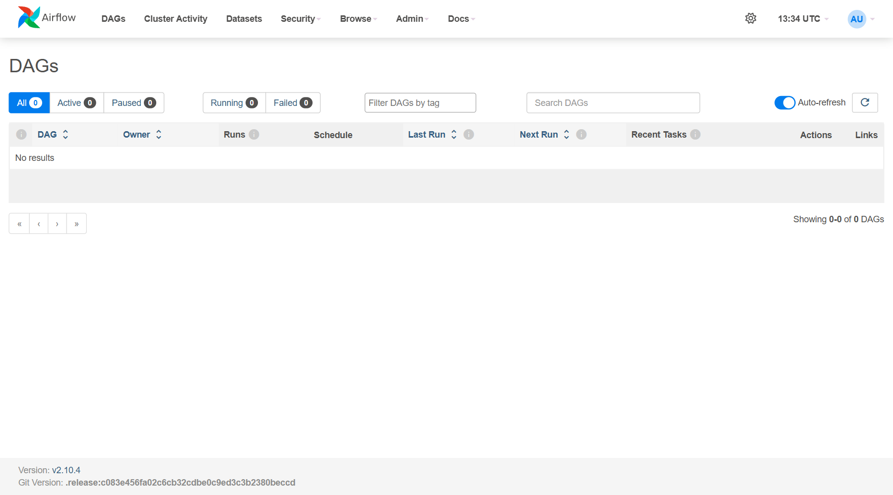

# 04 · Docker & docker-compose (Part B1 + B2)

## Images we build

| Image | Dockerfile | Base images | Runs as | Port |
|---|---|---|---|---|
| `btc-forecast-api` | [`app/Dockerfile`](../app/Dockerfile) | `python:3.10-slim` (builder + runtime) | `appuser` (uid 1000) | 5000 |
| `btc-forecast-ui` | [`frontend/Dockerfile`](../frontend/Dockerfile) | `node:20-alpine` → `nginx-unprivileged:1.27-alpine` | `nginx` (uid 101) | 8080 |

## B1 · Multi-stage API Dockerfile: what each part does

```
Stage 1  "builder"   python:3.10-slim
  └─ create virtualenv /opt/venv
  └─ COPY app/requirements.txt   ← copied alone, so this layer is cached
  └─ pip install                 ← re-runs only if requirements change

Stage 2  "runtime"   python:3.10-slim  (fresh, no pip cache, no build files)
  └─ apt install libgomp1        ← OpenMP runtime needed by LightGBM/XGBoost
  └─ create non-root user appuser
  └─ COPY --from=builder /opt/venv
  └─ COPY src/  app.py  models/* → /app/seed_models
  └─ USER appuser
  └─ HEALTHCHECK  → GET /health
  └─ CMD gunicorn --bind 0.0.0.0:5000 --workers 2 --threads 2 app:app
```

Best practices used:
- **Multi-stage:** the final image has no compilers, pip cache or requirement files.
- **Small base:** `python:3.10-slim` instead of the 1 GB full image.
- **Layer caching:** requirements are installed before the source code is copied, so code changes rebuild in seconds.
- **Non-root user:** the container runs as `appuser`, not root.
- **`.dockerignore`:** keeps `.git`, `data/`, `Docs/`, `node_modules`, tests etc. out of the build context.
- **Health check:** Docker (and later Kubernetes) can see if the API is alive.
- **Seed model:** the trained model is baked in at `/app/seed_models`. On start-up, if `/app/models`
  (e.g. an empty Kubernetes volume) has no model, the API copies the seed model there.

### Build & run

```powershell
docker build -t btc-forecast-api:latest -f app/Dockerfile .
docker run --rm -p 5000:5000 btc-forecast-api:latest
curl http://localhost:5000/health

docker build -t btc-forecast-ui:latest frontend
docker run --rm -p 3000:8080 -e API_UPSTREAM=host.docker.internal:5000 btc-forecast-ui:latest
# open http://localhost:3000
```

Check that it is not running as root:
```powershell
docker run --rm btc-forecast-api:latest whoami      # -> appuser
```

## UI container: how the dashboard reaches the API

The React app always calls **`/api/...`** on its own address. Nginx inside the UI container forwards
`/api/*` to `API_UPSTREAM` (an environment variable):

| Where | `API_UPSTREAM` |
|---|---|
| docker-compose | `api:5000` (service name) |
| Kubernetes | `<api-service-name>:80` |
| plain `docker run` | `host.docker.internal:5000` |

So the browser never needs CORS settings and the same image works everywhere.

## B2 · docker-compose (integrated local environment)

File: [`docker-compose.yml`](../docker-compose.yml)

| Service | Image | Port | Purpose |
|---|---|---|---|
| `api` | built from `app/Dockerfile` | 5000 | Flask + Gunicorn forecast API |
| `ui` | built from `frontend/Dockerfile` | 3000 | React dashboard |
| `postgres` | `postgres:16-alpine` | – | Airflow metadata database |
| `airflow-init` | `btc-airflow:2.10.4` (built inline, see below) | – | One-time: DB migrate + create admin user |
| `airflow-webserver` | same | 8080 | Airflow UI |
| `airflow-scheduler` | same | – | Runs the DAG tasks |

**Airflow image:** `docker-compose.yml` builds a small image on top of the official
`apache/airflow:2.10.4-python3.10` (with `dockerfile_inline`, so no extra folder is needed). It adds
`libgomp1` (needed by LightGBM) and the same pinned ML libraries as the API image, so a model trained by
Airflow loads in the API without version problems.

Shared folders (bind mounts), so Airflow and the API see the same files:

```
./dags   → /opt/airflow/dags
./src    → /opt/airflow/src        (DAG imports src.etl_fetch, src.features, src.train_forecast)
./data   → /opt/airflow/data
./models → /opt/airflow/models  and  /app/models (API)
```

After Airflow retrains, the DAG calls `POST http://api:5000/reload` (header `X-API-Key`) and the API
loads the new `models/model.pkl` without a restart.

### Commands

```powershell
copy .env.example .env               # once; edit values
docker compose up -d --build         # first build takes ~5 min, later starts ~1 min
docker compose ps                    # all services "running" / "healthy"
docker compose logs -f api           # follow API logs
docker compose down                  # stop (data in volumes is kept)
docker compose down -v               # stop and delete the Postgres/Airflow volumes
```

| URL | What |
|---|---|
| http://localhost:5000/health | API |
| http://localhost:3000 | Dashboard |
| http://localhost:8080 | Airflow (login from `.env`, default `admin` / `admin`) |

> Airflow + Postgres + API + UI need about 3–4 GB RAM. Stop compose (`docker compose down`)
> before starting Minikube on a laptop with 8 GB.

## Evidence

| | |
|---|---|
| Multi-stage build |  |
| Image sizes (API 803 MB incl. ML libs, UI 76 MB) |  |
| Non-root user |  |
| `docker compose ps` |  |
| Airflow UI from compose |  |

Image size note: the first API build was 1.97 GB because the standard `xgboost` wheel bundles NVIDIA GPU
libraries (~650 MB). Switching to the CPU-only `xgboost-cpu` package (same library, same model format)
brought it down to 803 MB.
