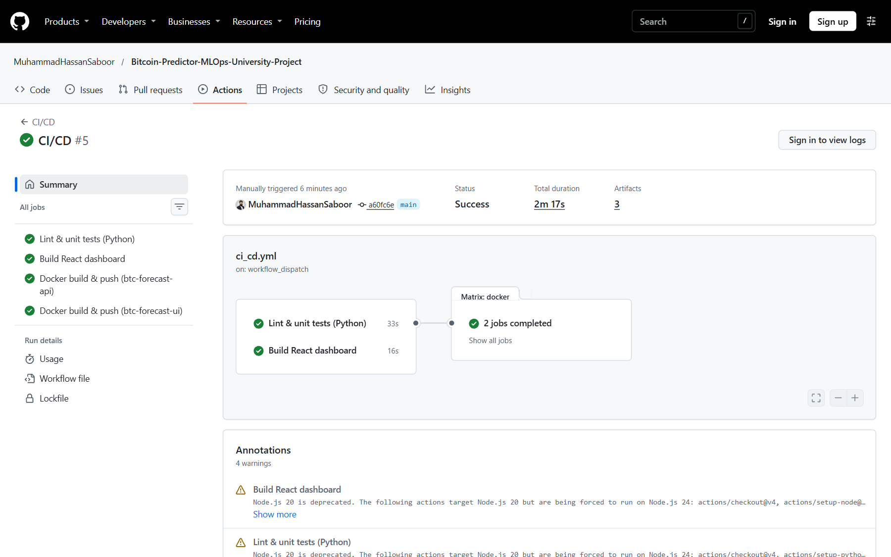
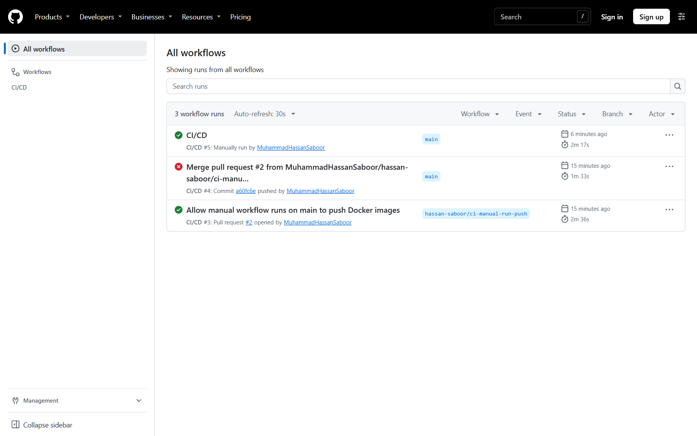
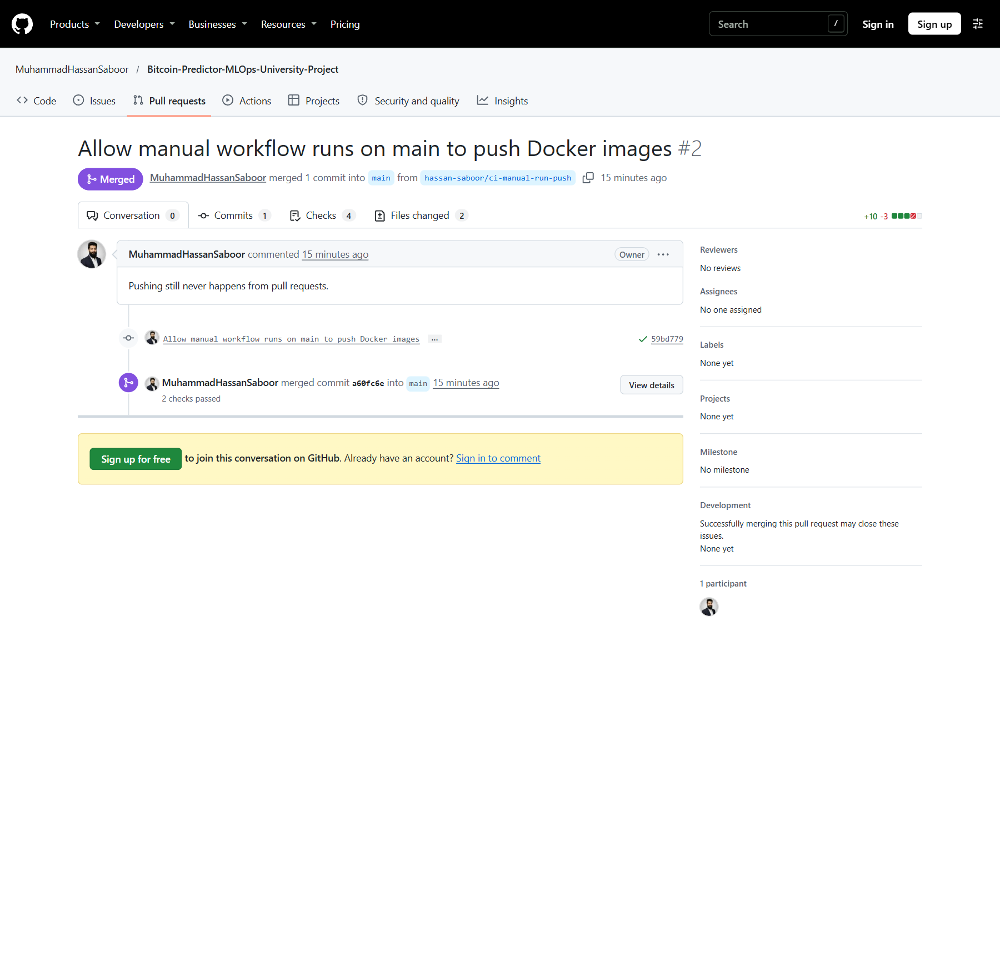
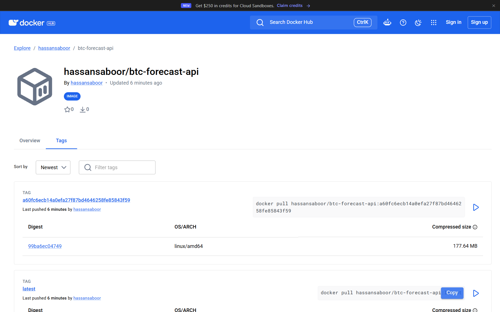

# 05 · CI/CD with GitHub Actions (Part B3 + B4)

File: [`.github/workflows/ci_cd.yml`](../.github/workflows/ci_cd.yml)

## When does it run?

| Event | What runs |
|---|---|
| Pull Request into `main` | Lint + tests + React build + Docker **build** (no push) |
| Push / merge into `main` | Everything above + Docker **push** to Docker Hub |
| Manual (*Actions → CI/CD → Run workflow*, branch `main`) | Everything, including the Docker **push** |

## Pipeline

```
┌──────────────────────────┐   ┌──────────────────────────┐
│ lint-and-test (Python)    │   │ frontend-build (Node 20)  │
│  1. pip install -r req…   │   │  1. npm ci                │
│  2. flake8 .              │   │  2. npm run build         │
│  3. black --check .       │   └────────────┬─────────────┘
│  4. pytest (41 tests)     │                │
└────────────┬─────────────┘                │
             └──────────────┬────────────────┘
                            ▼  (only if both pass)
        ┌──────────────────────────────────────────────┐
        │ docker (matrix: btc-forecast-api, -ui)        │
        │  1. docker login   (secrets, main only)       │
        │  2. build with Buildx + layer cache           │
        │  3. tag  :latest  and  :<git commit SHA>      │
        │  4. push to Docker Hub   (main only)          │
        └──────────────────────────────────────────────┘
```

## One-time setup (repository owner)

1. **Docker Hub access token:** hub.docker.com → *Account settings → Personal access tokens → Generate new token* (permission *Read & Write*). Copy it.
2. **GitHub secrets:** GitHub repo → *Settings → Secrets and variables → Actions → New repository secret*

   | Name | Value |
   |---|---|
   | `DOCKER_USERNAME` | your Docker Hub username |
   | `DOCKER_PASSWORD` | the access token from step 1 (not your real password) |

3. After the first push to `main`, open the two repositories on Docker Hub
   (`<user>/btc-forecast-api`, `<user>/btc-forecast-ui`) → *Settings → Visibility → Public*,
   so the links can be submitted and Kubernetes can pull the images without credentials.

The secrets are never printed in the logs; GitHub masks them automatically.

### Merged before adding the secrets?

The CD job needs the secrets at the moment it runs. If a PR was merged before they were added, either
open the next PR and merge it, or run the workflow by hand:
*Actions → CI/CD → Run workflow → Branch: main → Run workflow*. Both push the images.

## Run the same checks locally before pushing

```powershell
conda activate btc_mlops
black .            # auto-format
flake8 .           # lint
pytest             # unit tests
cd frontend; npm run build; cd ..
```

## Config files used by the checks

| File | Purpose |
|---|---|
| `.flake8` | max line length 100, ignores `frontend/`, `data/`, `models/` |
| `pyproject.toml` | black line length 100 + pytest settings |
| `requirements-dev.txt` | pinned versions of pytest / flake8 / black |

## Published images (deliverable)

| Image | Link | Tags |
|---|---|---|
| API | https://hub.docker.com/r/hassansaboor/btc-forecast-api | `latest`, `<git SHA>` |
| UI | https://hub.docker.com/r/hassansaboor/btc-forecast-ui | `latest`, `<git SHA>` |

```powershell
docker pull hassansaboor/btc-forecast-api:latest
docker pull hassansaboor/btc-forecast-ui:latest
```

## Evidence

| | |
|---|---|
| CI/CD run on `main` (all jobs green) |  |
| Workflow history |  |
| Pull request merged, checks passed |  |
| Docker Hub tags (API) |  |
| Docker Hub tags (UI) |  |

## Troubleshooting we hit

| Error in the Docker job | Cause | Fix |
|---|---|---|
| `401 Unauthorized: access token has insufficient scopes` | Docker Hub token was **Read-only** | New token with **Read & Write**, update `DOCKER_PASSWORD`, re-run |
| Images not pushed after the first merge | Secrets were added after the merge | *Actions → CI/CD → Run workflow* on `main` |
