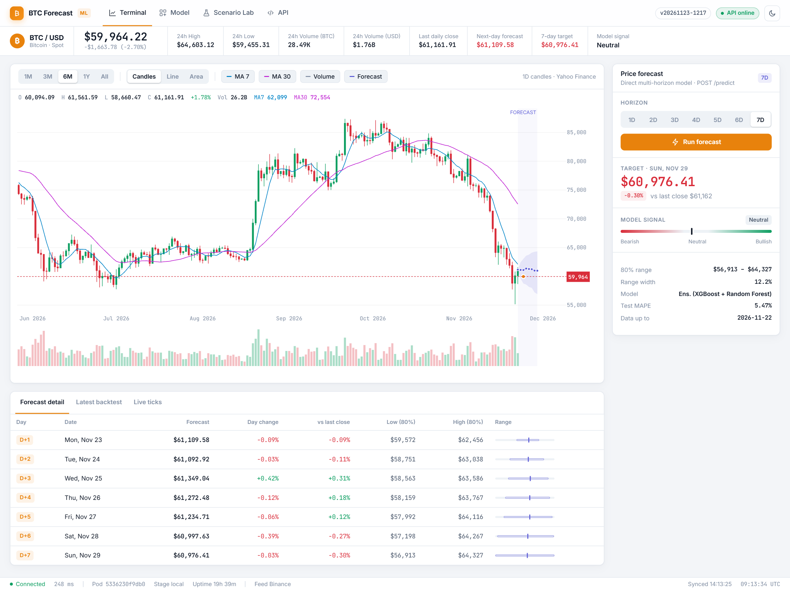
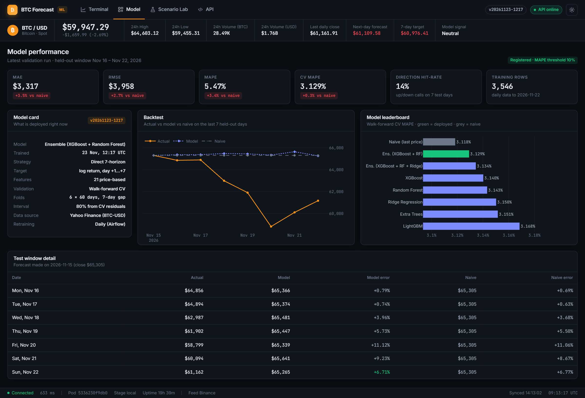
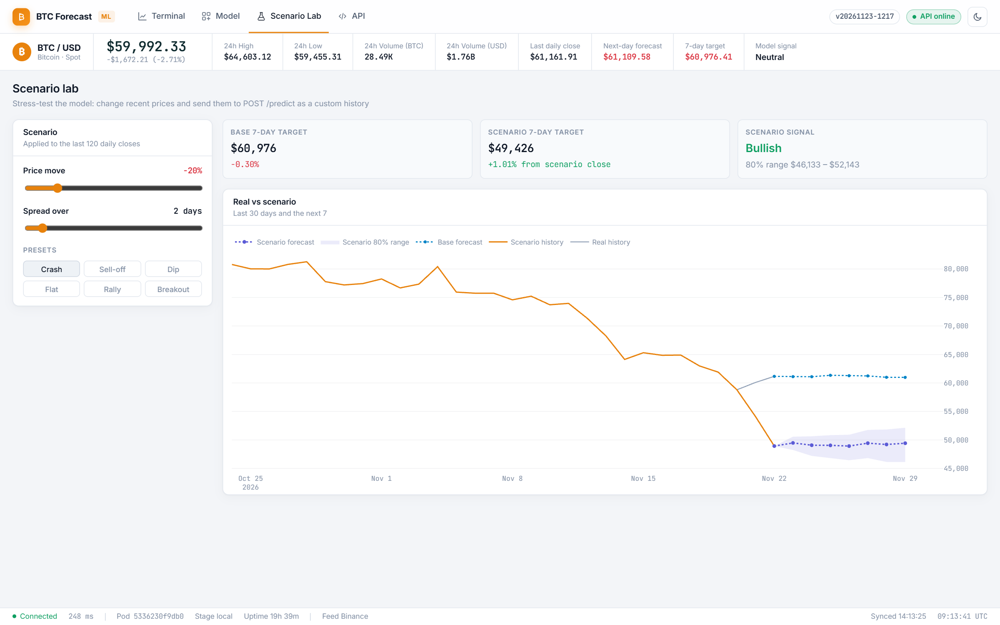
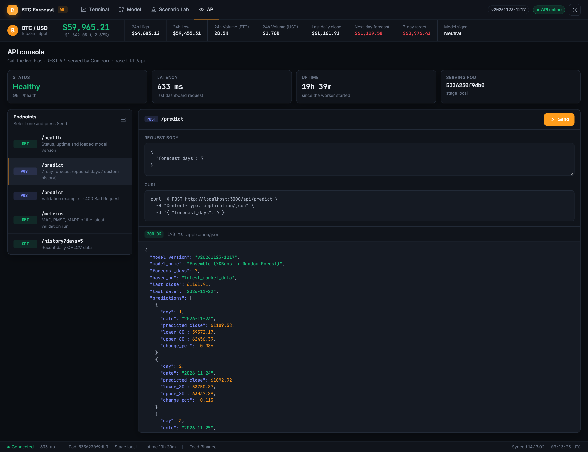
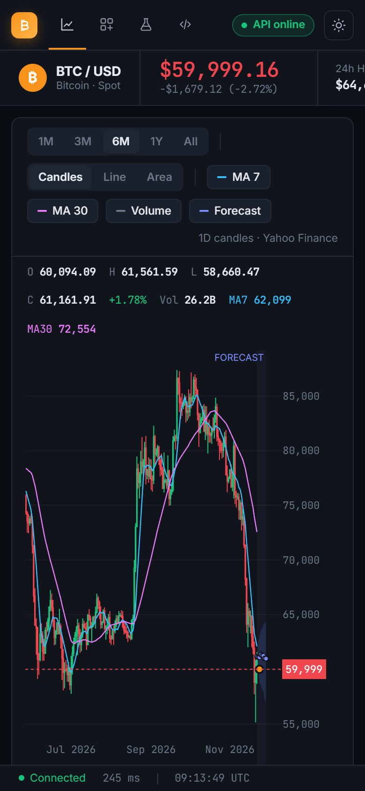

# 06 · React Dashboard: BTC Forecast Terminal (extra feature)

A trading-terminal style web app on top of the Flask API, built with **React 18 + Vite** and
**Plotly** charts. It has four pages, a live market feed, and a **dark / light theme**.


## Layout

```
┌ Top bar ─ brand · Terminal | Model | Scenario Lab | API · model version · API status · theme ┐
├ Market bar ─ BTC/USD live price · 24h high/low/volume · last close · next-day / 7-day forecast · signal ┤
│                                                                                              │
│                         page content (one of the four pages below)                           │
│                                                                                              │
└ Status bar ─ connection · API latency · serving pod · stage · uptime · feed · last sync · UTC ┘
```

## Pages

| Page | URL | What it shows | API calls |
|---|---|---|---|
| **Terminal** | `#/` | Candlestick / line / area chart with MA 7, MA 30, volume, the 7-day forecast and its 80% band in a shaded *forecast zone*, a live-price tag on the axis, and an OHLC readout. Side panel: horizon 1–7 days, target price, bullish/neutral/bearish signal meter, 80% range. Bottom tabs: forecast table (with range bars), latest backtest, live tick chart | `GET /history`, `POST /predict` |
| **Model** | `#/model` | KPIs (MAE, RMSE, MAPE, CV MAPE vs naive, direction hit-rate, training rows), model card, backtest chart, model leaderboard, day-by-day test-window table | `GET /metrics` |
| **Scenario Lab** | `#/scenario` | Move the last price by ±30% over 1–14 days (or pick a preset: Crash, Sell-off, Dip, Flat, Rally, Breakout) and compare the scenario forecast with the base forecast | `POST /predict` with a custom `history` |
| **API** | `#/api` | Live API console: pick an endpoint, edit the JSON body, press **Send**, see status code, latency and the highlighted JSON response, plus the matching `curl` command | all endpoints |

The data refreshes every 60 s. When the model version changes (after the Airflow DAG retrains), the
forecast is re-run automatically.

**Live market feed:** Binance WebSocket (`btcusdt@ticker`, one update per second); if that is blocked,
Coinbase REST is polled every 5 s.

## Screenshots

| | |
|---|---|
| Terminal (light) |  |
| Model (dark) |  |
| Scenario Lab (light) |  |
| API console (dark) |  |
| Mobile |  |

## Folder layout

```
frontend/
├── Dockerfile               multi-stage: node build → nginx-unprivileged
├── nginx.conf.template      serves the site, proxies /api/* → Flask
├── vite.config.js           dev server + /api proxy to localhost:5000
├── index.html
├── package.json / package-lock.json
└── src/
    ├── main.jsx · App.jsx   entry point, data loading, page switching
    ├── api.js               API client (with latency), formatting helpers, signal
    ├── styles.css           design tokens (dark/light) + all layout
    ├── hooks/
    │   ├── useTheme.js      theme (saved in the browser) + Plotly colours
    │   ├── useLivePrice.js  real-time price feed
    │   └── useHashRoute.js  #/ , #/model , #/scenario , #/api
    ├── components/
    │   ├── TopBar.jsx  MarketBar.jsx  StatusBar.jsx  Icons.jsx
    │   ├── PriceChart.jsx  ForecastPanel.jsx  ForecastTable.jsx
    │   ├── BacktestChart.jsx  Leaderboard.jsx  LiveTicks.jsx
    │   └── Plot.jsx         Plotly wrapper (finance bundle = smaller)
    └── views/
        ├── TerminalView.jsx  ModelView.jsx  ScenarioView.jsx  ApiView.jsx
```

## Run it

**Development** (hot reload):
```powershell
conda activate btc_mlops
python app/app.py                 # terminal 1: API on :5000
cd frontend; npm run dev          # terminal 2: http://localhost:5173
```

**Production build** (what the Docker image serves):
```powershell
cd frontend
npm run build                     # output in frontend/dist
```

**Docker / compose:** see [04_DOCKER_AND_COMPOSE.md](04_DOCKER_AND_COMPOSE.md). The dashboard is on http://localhost:3000.
**Kubernetes:** served at http://btc-forecast.local/ (see [11_KUBERNETES.md](11_KUBERNETES.md)).

## Theme

- The sun/moon button in the top bar switches theme; the choice is saved in the browser.
- `?theme=light` or `?theme=dark` in the URL forces a theme (used for screenshots).
- Colours are CSS variables in `styles.css` (`:root[data-theme="dark"|"light"]`); Plotly colours come
  from `chartColors()` in `useTheme.js`.
