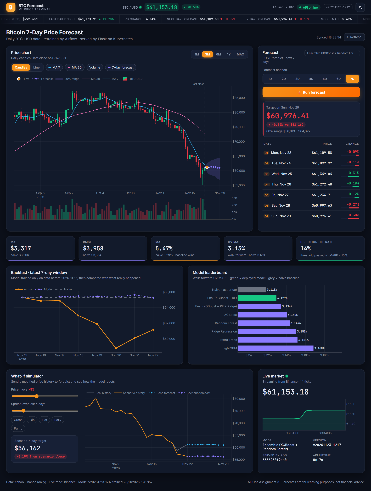

# 06 · React Dashboard (extra feature)

A stock-market style web app on top of the Flask API. It is built with **React 18 + Vite**,
the charts use **Plotly**, and it has a **dark / light theme** switch.



## Features

| Area | What it shows | Data source |
|---|---|---|
| Navbar | Live BTC/USD price (flashes green/red on every tick), 24h change, UTC clock, API status, model version, 🌙/☀️ theme button | Binance WebSocket (fallback: Coinbase REST) + `GET /health` |
| Ticker tape | Scrolling 24h high/low/volume, last daily close, 7-day change, next-day & 7-day forecast, model MAPE | live feed + API |
| Price chart | Candlesticks or line, MA 7, MA 30, volume bars, 7-day forecast with 80% range, live price marker; 1M/3M/6M/1Y/MAX ranges, zoom/pan | `GET /history`, `POST /predict` |
| Forecast panel | Choose 1–7 days, run the forecast, target price headline, table with daily change bars | `POST /predict` |
| KPI cards | MAE, RMSE, MAPE (vs naive baseline), walk-forward CV MAPE, direction hit-rate, threshold pass/fail | `GET /metrics` |
| Backtest chart | Latest 7-day test window: actual vs model vs naive | `GET /metrics` |
| Model leaderboard | Every model family tried, ranked by CV MAPE | `GET /metrics` |
| What-if simulator | Move the latest price by ±30% over 1–14 days and see how the forecast reacts | `POST /predict` with a custom `history` |
| Live market | Real-time tick chart + which pod served the request + API uptime | live feed + `GET /health` |

The page refreshes API data every 60 s and re-runs the forecast automatically when the
model version changes (for example after Airflow retrains the model).

## Folder layout

```
frontend/
├── Dockerfile               multi-stage: node build → nginx-unprivileged
├── nginx.conf.template      serves the site, proxies /api/* → Flask
├── vite.config.js           dev server + /api proxy to localhost:5000
├── index.html
├── package.json / package-lock.json
└── src/
    ├── main.jsx             entry point
    ├── App.jsx              page layout + data loading
    ├── api.js               fetch helpers + number formatting
    ├── styles.css           design tokens (dark/light) + layout
    ├── hooks/
    │   ├── useTheme.js      theme state (saved in localStorage) + Plotly colours
    │   └── useLivePrice.js  real-time price feed
    └── components/
        ├── Navbar.jsx  TickerTape.jsx  PriceChart.jsx  ForecastPanel.jsx
        ├── MetricsCards.jsx  BacktestChart.jsx  Leaderboard.jsx
        ├── WhatIf.jsx  LiveTape.jsx
        └── Plot.jsx         Plotly wrapper (finance bundle = smaller)
```

## Run it

**Development** (hot reload):
```powershell
conda activate btc_mlops
python app/app.py                 # terminal 1: API on :5000
cd frontend; npm run dev          # terminal 2: http://localhost:5173
```

**Production build** (what the Docker image serves):
```powershell
cd frontend
npm run build                     # output in frontend/dist
```

**Docker / compose:** see [04_DOCKER_AND_COMPOSE.md](04_DOCKER_AND_COMPOSE.md). The dashboard is on http://localhost:3000.

## Theme

- The button in the navbar switches between dark and light.
- The choice is saved in the browser (localStorage).
- `?theme=light` or `?theme=dark` in the URL forces a theme (used for screenshots).
- All colours are CSS variables in `styles.css` (`:root[data-theme="dark"]` / `"light"`); Plotly
  colours come from `chartColors()` in `useTheme.js`.

## Kubernetes notes (for Part D)

Deploy the `btc-forecast-ui` image as its own Deployment + Service (container port **8080**) and set
the env var `API_UPSTREAM=<api-service-name>:80`. In the Ingress, route `/` to the UI service.
