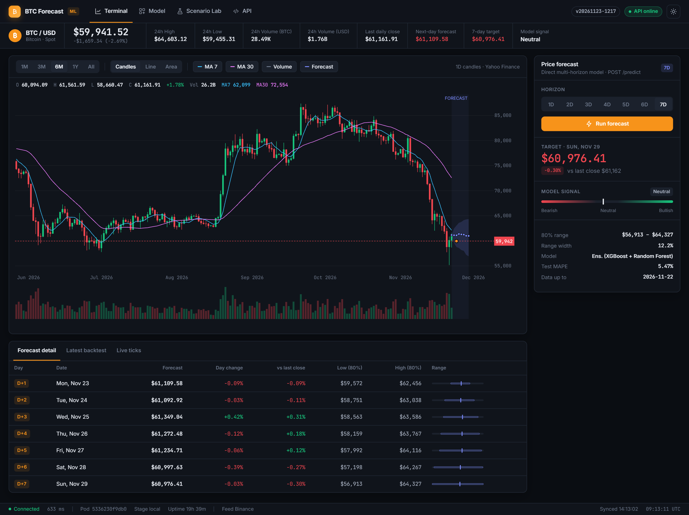

# Bitcoin 7-Day Price Predictor: Production MLOps Pipeline

An end-to-end MLOps system that ingests daily Bitcoin (BTC-USD) prices, retrains a forecasting model,
and serves a **7-day closing-price forecast** through a Flask REST API and a real-time React dashboard.
The system is containerised with Docker, tested and shipped by GitHub Actions, orchestrated with
Airflow / Kubeflow and deployed on Kubernetes.

**MLOps Assignment 3** · Group:
| Name | Roll No | Responsibilities |
|---|---|---|
| Muhammad Hassan Saboor | 25L-8014 | Data, ML model, Flask API, React UI, Docker, CI/CD |
| Mudassar Zulfiqar | 24L-8000 | ETL (Airflow), Kubeflow, Kubernetes |



## Architecture

```
          ┌──────────── GitHub ────────────┐
 git push │  Actions: flake8 · black ·     │  docker push
 ───────▶ │  pytest · npm build · docker   │ ───────────▶ Docker Hub
          └────────────────────────────────┘                 │ (api + ui images)
                                                             ▼
 Yahoo Finance ─▶ Airflow DAG (daily)                 Kubernetes (Minikube)
                 fetch → features → train/eval  ┌───────────────────────────────┐
                           │ register if        │ Ingress btc-forecast.local    │
                           ▼ MAPE < 10%         │   ├─ /      → UI pods (Nginx)  │
                     models/ (PVC) ───────────▶ │   └─ /api   → API pods (Flask) │
                           │                    │ HPA 2–8 pods · probes /health  │
                           └─ POST /reload ───▶ │ ConfigMap · Secret · PVC       │
                                                └───────────────────────────────┘
```

## Repository structure

```
app/                     Flask API (app.py), Dockerfile, requirements.txt
src/                     etl_fetch.py, features.py, train_forecast.py, forecaster.py, config.py
frontend/                React + Plotly dashboard, Dockerfile, nginx.conf.template
tests/                   pytest unit tests (API + pipeline)
models/                  registered model: model.pkl, metrics.json, model_version.txt
dags/                    Airflow DAG: btc_etl_pipeline.py
kubeflow/                Kubeflow pipeline: btc_kfp_pipeline.py (+ compiled YAML)
k8s/                     Kubernetes manifests
loadtest/                Locust load test for the HPA demo
.github/workflows/       ci_cd.yml
docker-compose.yml       API + UI + Airflow + Postgres for local integration
Docs/                    roadmap, step-by-step docs, screenshots, logs
```

## Quick start

```powershell
# 1. Python env
conda create -n btc_mlops python=3.10 -y
conda activate btc_mlops
pip install -r requirements-dev.txt

# 2. Data + model
python src/etl_fetch.py
python src/features.py
python src/train_forecast.py --tune

# 3. API + tests
pytest
python app/app.py                       # http://localhost:5000/health

# 4. Dashboard
cd frontend; npm install; npm run dev   # http://localhost:5173

# 5. Everything in containers (API, UI, Airflow, Postgres)
copy .env.example .env
docker compose up -d --build            # UI :3000 · API :5000 · Airflow :8080
```

## API

| Method | Endpoint | Description |
|---|---|---|
| GET | `/health` | status, uptime, model version |
| POST | `/predict` | `{"forecast_days": 7}` → 7 dates + predicted closes (+ 80% range); accepts a custom `history` |
| GET | `/metrics` | MAE, RMSE, MAPE of the latest validation run |
| GET | `/history` | recent OHLCV for charts |
| POST | `/reload` | reload model after retraining (needs `X-API-Key`) |

## Deliverables

| Deliverable | Link |
|---|---|
| Technical report (PDF, 6 pages) | [Docs/BTC_Forecast_MLOps_Assignment3_Report.pdf](Docs/BTC_Forecast_MLOps_Assignment3_Report.pdf) |
| Docker images | [hassansaboor/btc-forecast-api](https://hub.docker.com/r/hassansaboor/btc-forecast-api) · [hassansaboor/btc-forecast-ui](https://hub.docker.com/r/hassansaboor/btc-forecast-ui) |
| Airflow DAG | [dags/btc_etl_pipeline.py](dags/btc_etl_pipeline.py) |
| Kubeflow pipeline | [kubeflow/btc_kfp_pipeline.py](kubeflow/btc_kfp_pipeline.py) · [compiled YAML](kubeflow/btc_kfp_pipeline.yaml) |
| Kubernetes manifests | [k8s/](k8s/) |
| CI/CD workflow | [.github/workflows/ci_cd.yml](.github/workflows/ci_cd.yml) |

## Documentation

Everything is explained step by step in [`Docs/`](Docs/README.md).

## License

MIT, see [LICENSE](LICENSE).
